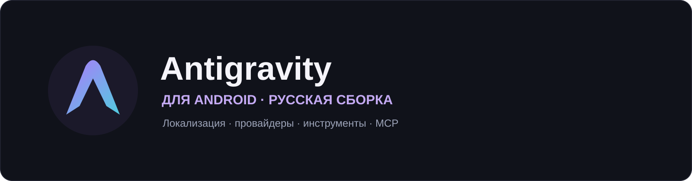
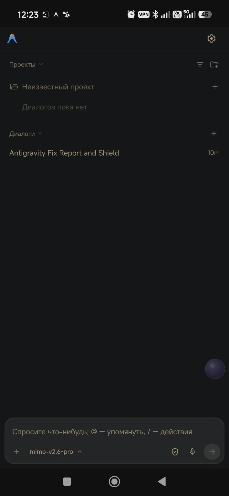
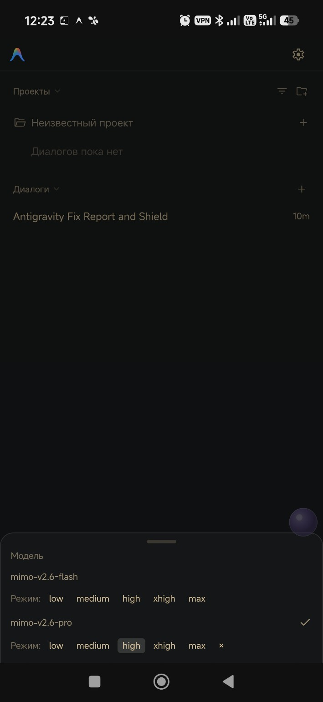
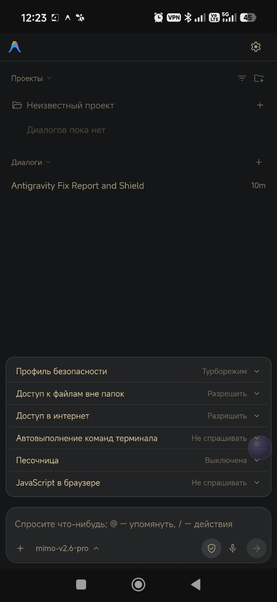
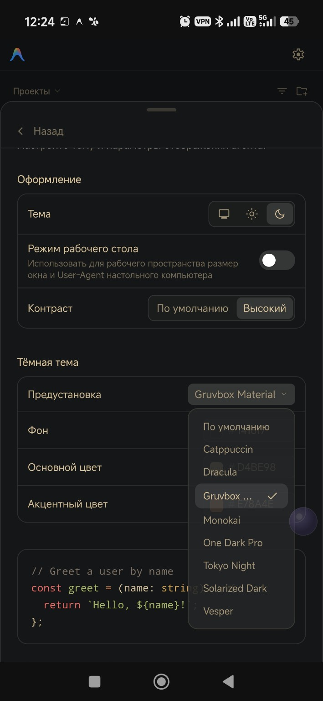
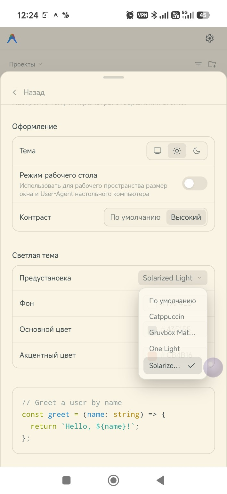
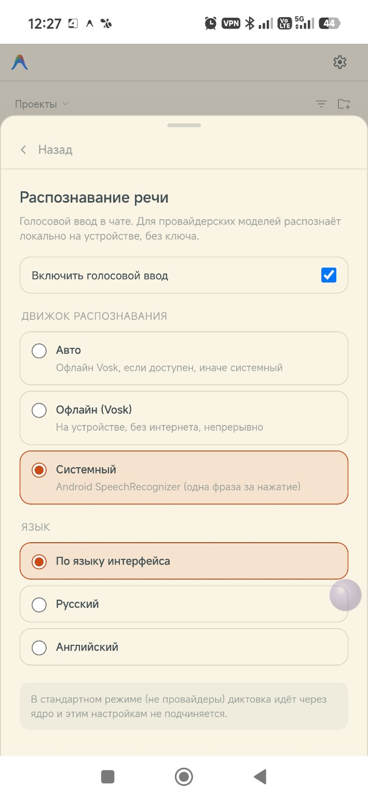

<p align="center"></p>

<p align="center"><b>Среда разработки с ИИ-агентом на Android.</b><br>Русский интерфейс, настройки безопасности, инструменты и пользовательские модели.</p>

<p align="center">
  <a href="https://github.com/Leostrange/antigravity-android/releases/tag/v2.4.1-ru"></a>
  
  <a href="LICENSE"></a>
</p>

<p align="center"><a href="https://github.com/Leostrange/antigravity-android/releases/download/v2.4.1-ru/Antigravity-BP-2.4.1-ru.fixed-ui-9-standard.apk"><b>Скачать Standard</b></a> · <a href="https://github.com/Leostrange/antigravity-android/releases/download/v2.4.1-ru/Antigravity-BP-2.4.1-ru.fixed-ui-9-bypass.apk"><b>Скачать Bypass</b></a> · <a href="https://github.com/Leostrange/antigravity-android/releases/tag/v2.4.1-ru">Все файлы релиза</a></p>

<p align="center"><sub>На основе <a href="https://github.com/werdio325-png/antigravity-android">werdio325-png/antigravity-android</a> · Русская сборка <a href="https://github.com/Leostrange">Leostrange</a></sub></p>

## О проекте

Antigravity работает в Android userspace на ARM64. Агент помогает изучать проекты, редактировать файлы, запускать команды и проверять результаты прямо на устройстве. Эта сборка добавляет русскую локализацию, компактный интерфейс и настройки работы агента.

## Скриншоты

<table>
<tr><td align="center"><b>Главный экран</b></td><td align="center"><b>Модели и мышление</b></td><td align="center"><b>Щит безопасности</b></td></tr>
<tr><td></td><td></td><td></td></tr>
<tr><td align="center"><b>Тёмная тема</b></td><td align="center"><b>Светлая тема</b></td><td align="center"><b>Диктовка</b></td></tr>
<tr><td></td><td></td><td></td></tr>
</table>

## Возможности

- **полная русификация** интерфейса: словарь EN → RU, статусы действий агента, живой индикатор рассуждений, русская плюрализация;
- **щит безопасности** в чате: профиль безопасности, доступ к файлам и интернету, автовыполнение команд терминала, песочница и JavaScript — с реально сохраняющимися выборами;
- **автономный режим агента**: «Не спрашивать» (EAGER) — агент работает без лишних подтверждений;
- **темы** списков и окон, светлая и тёмная схемы, компактные меню, попапы и выпадающие списки;
- **компактный чат** с вложениями до 10 файлов (просмотр и удаление прикреплённого);
- настройки диктовки, режимы мышления, экспорт сессий;
- встроенные инструменты разработки (Tools) и бэкенд настроек;
- **MCP-серверы** (sequential-thinking, exa, github-mcp-server, StitchMCP) — в том числе с кастомными провайдерами.

## Сборки

| Сборка | Назначение | Файл |
|---|---|---|
| **Standard** | базовая, без обхода региональных ограничений | [Скачать Standard](https://github.com/Leostrange/antigravity-android/releases/download/v2.4.1-ru/Antigravity-BP-2.4.1-ru.fixed-ui-9-standard.apk) |
| **Bypass** | с обходом региональных ограничений (region bypass) | [Скачать Bypass](https://github.com/Leostrange/antigravity-android/releases/download/v2.4.1-ru/Antigravity-BP-2.4.1-ru.fixed-ui-9-bypass.apk) |

Region bypass — патч Go-ядра `liblanguage_server.so`: в трёх местах байтовые проверки заменены на запись константы `1` (форс-пропуск), плюс обновляется `assets/runtime/manifest.json` с sha256 ядра. В standard-сборке стоят оригинальные инструкции, в bypass — патченые. Дельта лежит отдельно в `variants/bypass/`.

## Установка

1. Скачайте APK из [релиза](https://github.com/Leostrange/antigravity-android/releases/tag/v2.4.1-ru) и сверьте SHA-256 с файлом [`SHA256SUMS.txt`](https://github.com/Leostrange/antigravity-android/releases/download/v2.4.1-ru/SHA256SUMS.txt).
2. Установка идёт **поверх** `com.agyru.bp` — подпись совпадает, данные и сессии сохраняются.
3. После установки перезапустите приложение. Настройки щита применяются сразу и хранятся в `config.json`.

## MCP-серверы

- **Требуется Node.js**: `pkg install nodejs-lts`.
- **Процедура**: серверы добавляются из стандартного провайдера Antigravity, затем переключается ядро.
- **Шаблон конфига** — [`mcp_config.example.json`](mcp_config.example.json): каждый сервер запускается через `node <entrypoint.js>` с обязательными `LD_LIBRARY_PATH=$PREFIX/lib`, `PATH` и `NODE_PATH` в блоке `env`. Рабочий конфиг кладётся в `~/.gemini/config/mcp_config.json`.
- Проверено: `sequential-thinking`, `exa`, `github-mcp-server`, `StitchMCP` (mcp-remote) — суммарно 45 инструментов в статусе `MCP_SERVER_STATUS_READY`; вызовы пробрасываются шлюзом `AgyGateway` в кастомные модели по протоколу OpenAI.

## Ограничения ядра

1. **Стандартные и кастомные модели нельзя использовать одновременно.** Встроенные модели (Gemini / Claude / ChatGPT) и кастомные модели (провайдеры) работают только по отдельности — между ними переключается ядро.
2. **Плагины и MCP-серверы** в настройках пользователя также доступны только при переключённом ядре.
3. **Кастомные модели работают только с Android Speech Cognition** (транскрибация речи через микрофон) — встроенная голосовая цепочка им недоступна, это ограничение ядра.

## Состав репозитория

```text
├── README.md, CHANGELOG.md, LICENSE
├── assets/antigravity-bp-banner.svg       баннер проекта (стилистика Leostrange)
├── app/                                   ПОЛНОЕ дерево APK без подписи
│   ├── AndroidManifest.xml, classes*.dex, resources.arsc, res/
│   └── assets/
│       ├── web/                           веб-интерфейс и мод (то, что правится)
│       │   ├── generated/main.js          бандл React-приложения
│       │   ├── agy_ru.css, agy_shield.js, agy_i18n.js, agy_tools.* …
│       ├── runtime/                       Go-ядро (liblanguage_server.so) и рантайм
│       └── env/                           bootstrap userspace, оверлей и пакеты
├── variants/bypass/                       дельта bypass-билда (manifest + патченое ядро)
├── rebuild.py                             скрипт сборки standard / bypass
├── compress-map.json                      файлы, хранимые в APK без сжатия
├── mcp_config.example.json                шаблон конфига MCP-серверов
├── tools/uber-apk-signer.jar              подпись + zipalign
└── dist/antigravity-debug.keystore        ключ подписи (встаёт поверх установленного)
```

> [!NOTE]
> Полный архив исходников — [`Antigravity-BP-repo.zip`](https://github.com/Leostrange/antigravity-android/releases/tag/v2.4.1-ru) в релизе. Два файла ядра `liblanguage_server.so` (по 181 МБ) не хранятся в git из-за лимита GitHub в 100 МБ на файл — они внутри APK и в архиве исходников.

## Сборка APK

Нужны Python 3 и Java (OpenJDK 17):

```bash
python3 rebuild.py            # оба APK (standard + bypass)
python3 rebuild.py standard   # только standard
python3 rebuild.py bypass     # только bypass
```

Готовые подписанные APK появятся в `dist/signed/`. Подпись — `dist/antigravity-debug.keystore`, поэтому APK встаёт **поверх** установленного `com.agyru.bp` без потери данных.

Все правки интерфейса лежат в `app/assets/web/` — после изменений достаточно пересобрать.

## Лицензия

Код проекта распространяется по лицензии [Apache 2.0](LICENSE). Antigravity, Gemini и сторонние компоненты принадлежат соответствующим авторам и распространяются по их собственным лицензиям. Оригинальный проект: [werdio325-png/antigravity-android](https://github.com/werdio325-png/antigravity-android).

---

<p align="center"><sub>Part of the <a href="https://github.com/Leostrange">Leostrange</a> open-source projects.</sub></p>
